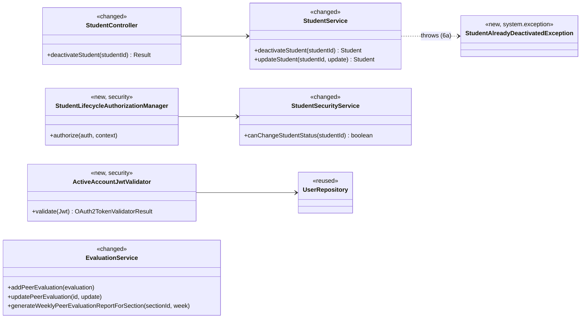
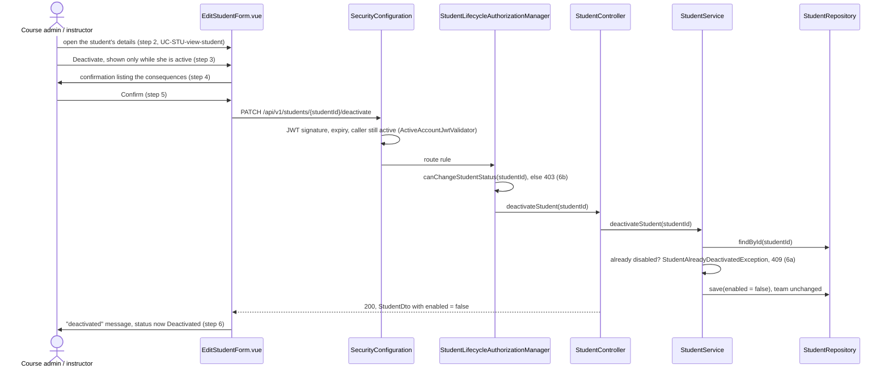
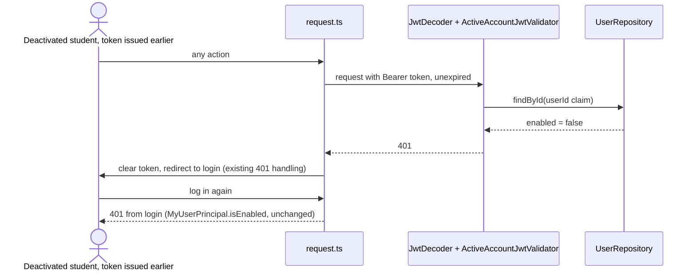

# Student (STU) Design

> Realizes: UC-STU-deactivate-student
> Depends on: FR-SEC-active-account, FR-SEC-deny-unauthorized, FR-SEC-authorization, BR-student-lifecycle, BR-deactivated-student-evaluation, BR-submission-owed, BR-team-admin-only, BR-section-scoped-access
> See: [use cases](../requirements/use-cases.md#student), [SRS security requirements](../requirements/software-requirements-specification.md#security-and-authorization-requirements), [architectural-design.md](architectural-design.md#shared-foundation-components) (shared foundation component view, Crosscutting Concepts, [Authorization](architectural-design.md#authorization))
> Designed against `main` at `59f0267` (2026-11-06).

## Overview

This area manages a student's account inside her course section: finding, viewing, deleting, and, with this design, deactivating her. It is the `student` feature slice in the REST API container, on the shared foundation. Deactivation is the first STU use case designed through `/design`.

Before this design, deactivation was the Status dropdown on `EditStudentForm.vue`, saved through the generic `PUT /students/{studentId}`, whose `StudentService.updateStudent` copied `enabled` for any `ROLE_instructor` caller: no warning, no extension flows, no test. Login already refused a disabled account (`MyUserPrincipal.isEnabled`), but a JWT issued before deactivation stayed valid for its full two hours, because nothing on the request path re-reads the account. Teammates were still asked to evaluate a deactivated student, and `EvaluationService.addPeerEvaluation` accepted it.

## Components & classes

- Backend, `student/`: [`StudentController`](../../backend/src/main/java/team/projectpulse/student/StudentController.java) and [`StudentService`](../../backend/src/main/java/team/projectpulse/student/StudentService.java) gain `deactivateStudent`; `updateStudent` stops copying `enabled`. [`StudentSecurityService`](../../backend/src/main/java/team/projectpulse/student/StudentSecurityService.java) gains `canChangeStudentStatus`.
- Backend, `security/`: new `ActiveAccountJwtValidator`, installed on the `jwtDecoder()` bean in [`SecurityConfiguration`](../../backend/src/main/java/team/projectpulse/security/SecurityConfiguration.java); new `authorizationmanagers/StudentLifecycleAuthorizationManager`, the same thin shape as `StudentInstructorAuthorizationManager`.
- Backend, `system/exception/`: new `StudentAlreadyDeactivatedException`, mapped in `ExceptionHandlerAdvice`.
- Backend, `evaluation/`: [`EvaluationService`](../../backend/src/main/java/team/projectpulse/evaluation/EvaluationService.java), for BR-deactivated-student-evaluation.
- Frontend: [`apis/student/index.ts`](../../frontend/src/apis/student/index.ts) gains `deactivateStudent`; [`EditStudentForm.vue`](../../frontend/src/pages/students/EditStudentForm.vue) replaces the Status dropdown with read-only status text and a **Deactivate** button; [`SubmitTeamsEvaluations.vue`](../../frontend/src/pages/evaluations/SubmitTeamsEvaluations.vue) lists only teammates whose account is active.
- Reused unchanged: `SubmissionStatusService.findOwedItems` (already skips a disabled student, BR-submission-owed), `MyUserPrincipal.isEnabled` (login), and the shared Axios instance's `401` / `403` / `409` handling in `frontend/src/utils/request.ts`.

## Sequence

### UC-STU-deactivate-student: main success scenario

Cancel at step 4 (5a) closes the dialog without a request.

### FR-SEC-active-account: the session she already has open

## API contract

| Endpoint or job | Caller (who may) | Request | Success | Errors, by extension |
|---|---|---|---|---|
| `PATCH /api/v1/students/{studentId}/deactivate` | The course admin of the student's course, or an instructor assigned to her course section (BR-student-lifecycle): `StudentLifecycleAuthorizationManager`, route rule added before the `denyAll()` catch-all | Path `studentId`; no body | `200`: `StudentDto` with `enabled: false`; team unchanged | 6a, already disabled: `409` `CONFLICT`, "This student is already deactivated." 6b, any other instructor, any student (herself included), or an id that names no student: `403` from the route rule. 5a: no request is sent |
| `PUT /api/v1/students/{studentId}` (existing) | Unchanged | `enabled` in the body is ignored | Unchanged | Unchanged |
| `POST /api/v1/evaluations` and the evaluation update (existing) | Unchanged | Unchanged | Unchanged | UC-EVA-submit-evaluation 9a, the evaluatee's account is disabled: `400` `INVALID_ARGUMENT`, naming the teammate |
| Every Bearer-authenticated request | Any | Unchanged | Unchanged | The token's user is missing or disabled: `401` (FR-SEC-active-account) |

## Key decisions

**A dedicated route, and the generic update stops changing `enabled`.** Deactivation has its own `PATCH .../deactivate`, and `updateStudent` no longer copies `enabled`, because the use case's Associated Information says a student is deactivated only through it. Rejected: keeping `enabled` on `PUT /students/{studentId}` and adding the warning in the UI only, which leaves the warning, 6a, and 6b one API call away from bypass. Accepted cost: the dropdown was also the only reactivation path, so until UC-STU-reactivate-student is built a student can be reactivated only in the database (OI-65). Dropping the `enabled` branch also removes `StudentService`'s `SecurityContextHolder` read, one of the three services OI-63 lists.

**An open session ends at its next request: a JWT validator.** `ActiveAccountJwtValidator` is an `OAuth2TokenValidator<Jwt>` composed with the default validators on the `jwtDecoder()` bean; it loads the user by the token's `userId` claim and fails the token if the user is missing or disabled, which the resource server reports as `401` through the existing `CustomBearerTokenAuthenticationEntryPoint`. Rejected: a `JwtAuthenticationConverter` that throws, which mixes authentication into authority mapping; a separate `OncePerRequestFilter`, a second place authentication is decided; a token-version claim or revocation list, which needs a column and a migration; and accepting the two-hour window, which FR-SEC-active-account forbids ("regardless of otherwise-valid credentials"). Accepted cost: one primary-key lookup per authenticated request. Side effect, same requirement and no extra code: a deactivated instructor's open session ends the same way.

**Who may deactivate.** `canChangeStudentStatus(studentId)` is true when the caller is the course admin of the student's course (`section.course.courseAdmin`) or is among her course section's instructors, and false for an id that names no student; it never throws (it runs in the filter chain, see [Authorization](architectural-design.md#authorization)). The route carries only the student's id, so the route rule is the scope check, and the service loads the student by that verified id. Rejected: `UserOwnershipAuthorizationManager`, the generic update's rule, which also admits the student herself; and `isCurrentUserInstructorOfStudentSection` alone, which refuses a course admin not listed among the course section's instructors although BR-student-lifecycle admits her.

**Already deactivated is a `409`, not a silent success.** 6a arises when someone else deactivated her after step 2; answering `200` would tell the instructor she did something she did not. Rejected: idempotent success.

**A deactivated student in the section report.** The weekly report keeps a student on a team when her account is active or she received at least one peer evaluation that week (BR-deactivated-student-evaluation), so her history stays and the weeks after she left show no empty row. Rejected: recording when she was deactivated and listing her for the weeks before it, which needs a column, a Flyway migration, and seed changes to tell apart weeks the rule already treats the same way.

**An evaluation of a deactivated student is refused on update as well as on add.** BR-deactivated-student-evaluation says such an evaluation "is not accepted", and BR-evaluation-editable-until-close makes a re-submission an update. Rejected: refusing only new evaluations, which would let an evaluation form opened before deactivation keep rewriting her scores until the window closes.

## Data model

No delta. `enabled` already lives on `PeerEvaluationUser`, which `Student` extends (SRS [Business Domain Model](../requirements/software-requirements-specification.md#business-domain-model)); deactivation flips it and leaves `Student.team` alone. No migration and no seed change.

## Reuse & cross-cutting

- Authorization: a new `AuthorizationManager` delegating to `StudentSecurityService`, per the two enforcement points in [Authorization](architectural-design.md#authorization).
- Error envelope: `StudentAlreadyDeactivatedException` maps to `409` / `StatusCode.CONFLICT` in `ExceptionHandlerAdvice`, which the shared Axios instance shows as a toast; the evaluation refusal reuses `PeerEvaluationIllegalArgumentException` (`400`).
- Who owes a submission: unchanged (`SubmissionStatusService`, BR-submission-owed); the deactivated student and her teammates' obligation to evaluate her drop out because it already filters on `enabled`.
- Confirmation dialog: `ElMessageBox.confirm`, as `Teams.vue` and `Sections.vue` use it.

## Tests

| Use case, flow | Level | Asserts |
|---|---|---|
| UC-STU-deactivate-student main, instructor | integration (`StudentIntegrationTest`) | An instructor assigned to the student's course section gets `200` and `enabled: false`; reloading her shows `enabled: false` and the same `teamId` |
| UC-STU-deactivate-student main, course admin | unit (`StudentSecurityServiceTest`) | `canChangeStudentStatus` is true for the course admin of her course who is not among her course section's instructors (built in memory; the seed puts every course admin in her course sections) |
| UC-STU-deactivate-student 5a | manual | Cancel at the confirmation sends no request and the status still reads Active |
| UC-STU-deactivate-student 6a | integration | Deactivating a disabled student returns `409` `CONFLICT`; she stays disabled |
| UC-STU-deactivate-student 6a | unit (`StudentServiceTest`) | `deactivateStudent` on a disabled student throws `StudentAlreadyDeactivatedException` and does not save |
| UC-STU-deactivate-student 6b, other course section | integration | An instructor not assigned to her course section and not her course admin gets `403`; she stays active |
| UC-STU-deactivate-student 6b, student | integration | A student, the target herself included, gets `403` |
| UC-STU-deactivate-student 6b, unknown id | unit (`StudentSecurityServiceTest`) | `canChangeStudentStatus` returns false for an id that names no student, without throwing |
| FR-SEC-active-account, open session | integration | A token obtained before deactivation gets `401` on her next request |
| FR-SEC-active-account, login | integration | HTTP Basic login as the deactivated student gets `401` |
| Single path | integration | `PUT /students/{studentId}` with `enabled: false` leaves her active |
| BR-deactivated-student-evaluation, submit (UC-EVA-submit-evaluation 9a) | unit (`EvaluationServiceTest`) | `addPeerEvaluation` and `updatePeerEvaluation` of a disabled evaluatee throw `PeerEvaluationIllegalArgumentException` |
| BR-deactivated-student-evaluation, report | unit (`EvaluationServiceTest`) | A disabled student with no evaluation that week is left out; with one she is listed; an active student with none is still listed |
| BR-deactivated-student-evaluation, form | manual | A deactivated teammate does not appear on `SubmitTeamsEvaluations.vue` |
| BR-submission-owed consequence | integration, existing | `SubmissionStatusServiceIntegrationTest.testAnEvaluationOfADeactivatedTeammateIsNotRequired`, cited, not rewritten |

## Open questions / risks

- **No in-app reactivation** until UC-STU-reactivate-student is built (OI-65). A mistaken deactivation is undone in the database.
- **Per-request lookup.** The validator adds one primary-key read to every authenticated request. At course scale (tens of concurrent users) this is negligible; not measured.
- **Frontend flows are checked by hand.** 5a and the teammate list have no automated test, because the repository has no frontend test harness for these pages.
